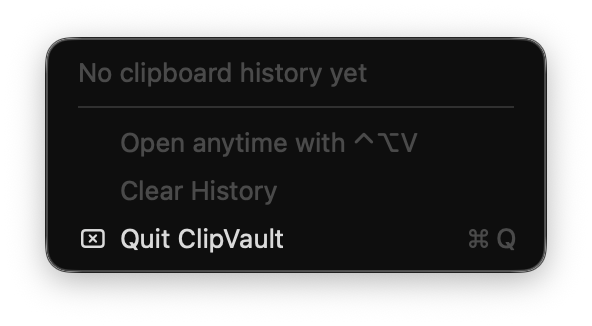

# 📋 ClipVault

A tiny, native macOS menu bar app that remembers the last **15 text items** you copied — click any of them to copy it back.

No Xcode project, no dependencies: one Swift file compiled with `swiftc`.

<p align="center">
  
</p>

## Features

- 🖥️ **Menu bar only.** A clipboard icon in the menu bar, with no Dock icon and no windows.
- 🕘 **Last 15 copies.** Text is captured automatically. If you copy something that's already in the list, it moves to the top instead of appearing twice.
- ⌨️ **Global shortcut.** Press **⌃⌥V** from any app to open the ClipVault menu. No Accessibility permission is needed.
- 🖱️ **Click to copy.** Pick an item from the dropdown and it goes back on your clipboard. Items 1–9 also have number-key shortcuts while the menu is open.
- 🧹 **Clear History** and **Quit** (⌘Q) in the menu.
- 🔒 **Privacy.** History lives only in memory and is never written to disk. Items that password managers mark as concealed or transient are skipped.
- 🪶 **Lightweight.** It checks the clipboard's change counter twice a second, which uses almost no CPU.

## Download

Grab **`ClipVault-v1.0.0-macOS.zip`** from the [latest release](https://github.com/jeevithreddyofficial/ClipVault/releases/latest). It's a universal build that runs on Apple Silicon and Intel Macs. Unzip it and drag `ClipVault.app` into `/Applications`.

> **First launch:** the app isn't notarized by Apple, so macOS will block it the first time. Right-click `ClipVault.app` → **Open** → **Open**. Or run:
> ```bash
> xattr -dr com.apple.quarantine /Applications/ClipVault.app
> ```

## Requirements (building from source)

- macOS 13 Ventura or later
- Swift toolchain (Xcode **or** the Command Line Tools: `xcode-select --install`)

## Build & Run

```bash
git clone https://github.com/jeevithreddyofficial/ClipVault.git
cd ClipVault
./build.sh
open ClipVault.app
```

To install it, drag `ClipVault.app` into `/Applications`. To start it at login, add it under **System Settings → General → Login Items**.

## Project Structure

```
ClipVault/
├── Sources/main.swift      # The entire app (AppKit)
├── Resources/Info.plist    # Bundle metadata (LSUIElement = menu-bar-only)
├── build.sh                # swiftc build → ClipVault.app
└── README.md
```

## How It Works

macOS gives no notification when the clipboard changes. ClipVault polls `NSPasteboard.general.changeCount` on a light timer instead. When the count changes, it reads the plain-text contents and adds them to the top of the list. The menu is rebuilt each time it opens, through `NSMenuDelegate.menuNeedsUpdate`.

## License

MIT
